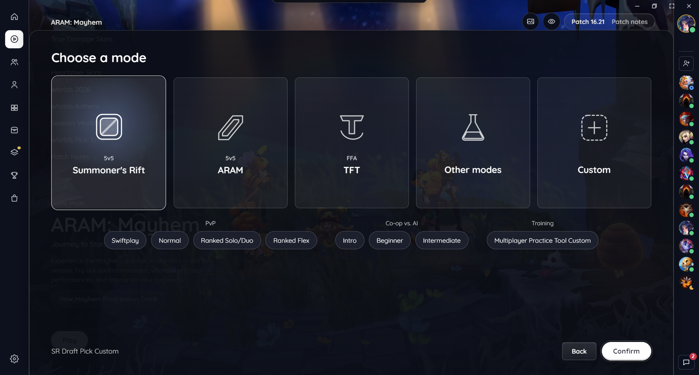
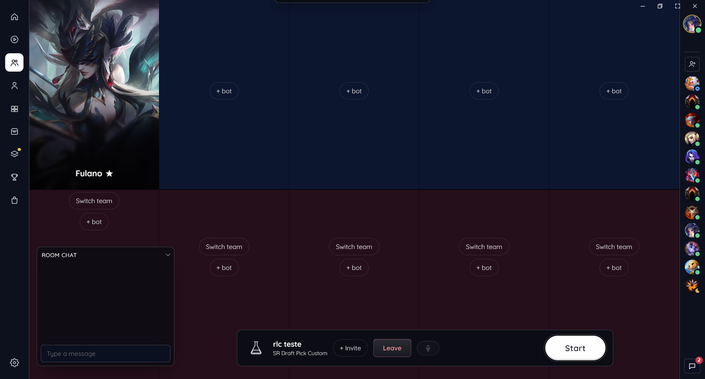
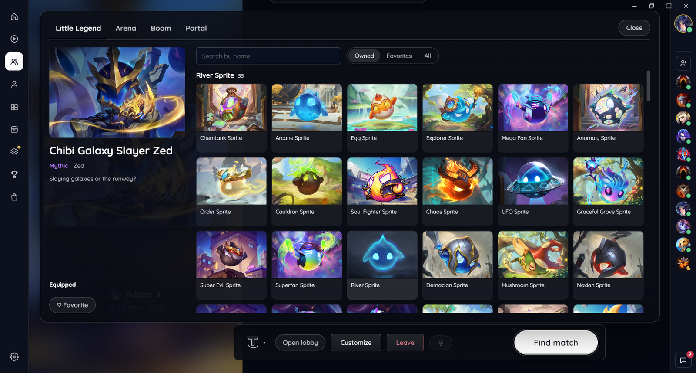
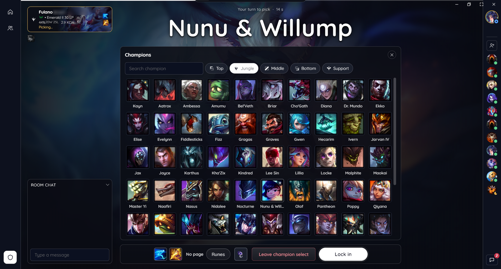
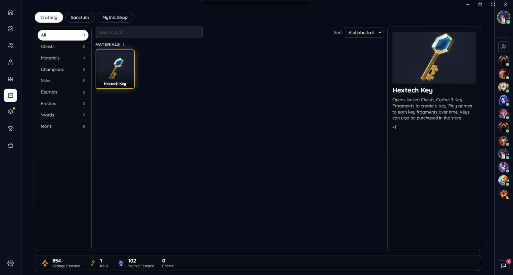
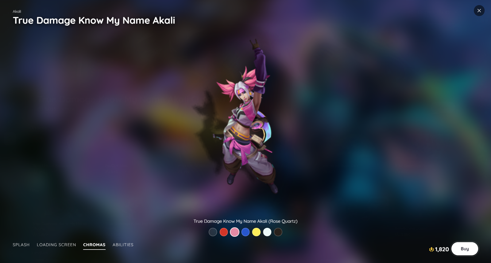
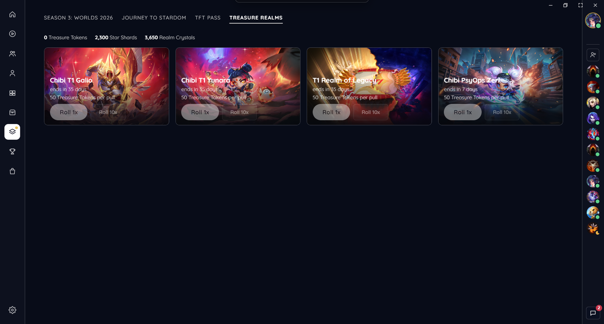
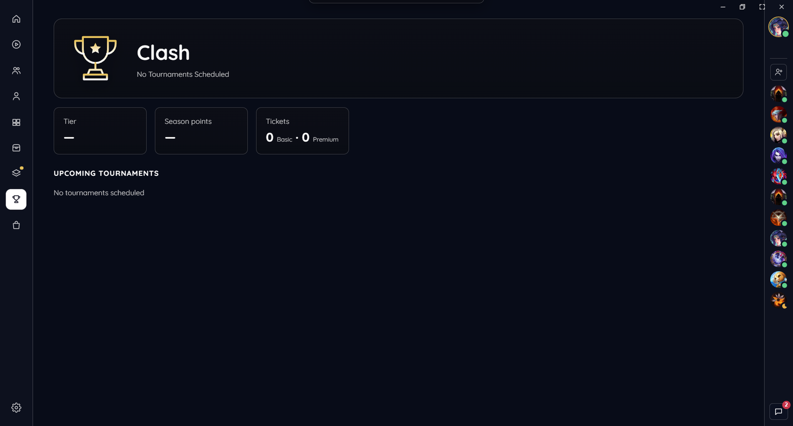

<div align="center">

# ReimaginedLC

**Uma interface nova para o client do League of Legends, feita como plugin do [Pengu Loader](https://pengu.lol).**

[English](README.md) · Português · [简体中文](README.zh-CN.md)


</div>

> [!WARNING]
> **Projeto não oficial.** O ReimaginedLC não é endossado pela Riot Games nem tem ligação com ela. Modificar o client é zona cinza nos termos da Riot. O Pengu Loader é tolerado hoje, sem garantia. Use por sua conta e risco.

## Sumário

- [O que ele faz](#o-que-ele-faz)
- [Imagens](#imagens)
- [Instalação](#instalação)
- [Primeiros passos](#primeiros-passos)
- [Plugins embutidos](#plugins-embutidos)
- [Atualizações](#atualizações)
- [Desligar e desinstalar](#desligar-e-desinstalar)
- [Problemas comuns](#problemas-comuns)
- [Temas e idioma](#temas-e-idioma)
- [Desenvolvimento](#desenvolvimento)
- [Licença](#licença)

## O que ele faz

O ReimaginedLC desenha as próprias telas por cima do client original. O client original continua rodando por baixo. Se uma tela der erro, só ela mostra um aviso com "Tentar de novo" e o resto continua; na seleção de campeões, onde o tempo corre, volta a seleção do client original. Funções que dependem de um endpoint conferem se o client instalado o tem: uma atualização do client esconde ou troca a função em vez de quebrar.

- **Início, lobby e fila.** Seletor de rotas no estilo do client. Na fila, uma pílula no canto mostra a fila e o tempo; ela estica de volta para a barra do lobby quando você volta.
- **Seleção de campeões.** Splash grande no palco e os nomes reais dos aliados. Cada cartão de aliado mostra elo, PDL, taxa de vitória e KDA. Também: carrossel de skins com prévia de cada skin (com ou sem cromas), skins de sentinela, favoritos por rota (botão direito) e runas por confronto. Na Arena, os picks de todos os subtimes, a Ousadia e os favoritos da torcida (bigorna).
- **Pós-jogo.** Resultado, seus números com a posição na partida, gráficos, progresso de PDL e maestria, e quem te honrou. O TFT tem classificação, tabuleiro e comp de cada jogador e comparação com o seu histórico.
- **Honra.** Honre aliados e inimigos, como no client atual.
- **Perfil.** Seu fundo, brasão e banner. "Histórico de partidas" abre uma folha de vidro com o feed, de LoL ou TFT.
- **Coleção e espólios.** Filtros e abas, criação e rerrolagem de espólios, Loja Mítica e o Santuário. Compras sempre pedem confirmação.
- **Loja e eventos.** Skins em destaque com nome e transição entre splashes. Skins, cromas e campeões abrem uma prévia em tela cheia (splash, splash animada, tela de carregamento, modelos das cromas, vídeos das habilidades) com Comprar. As ofertas da Sua Loja são reveladas ali mesmo. O passe do evento mostra desabilitadas as recompensas bloqueadas, os eventos trazem as missões de outras categorias (Journey to Stardom do ARAM Caos) e os Reinos dos Tesouros podem ser girados depois de confirmar.
- **Amigos e chat.** Gaveta que pode ficar fixa aberta, pastas que lembram o estado, cartão ao passar o mouse, chat da sala aberto por padrão e sons.
- **Configurações.** Editor de tema, fundo (imagem ou vídeo), modo leve para PCs fracos e idioma.

## Imagens

| | |
|---|---|
|  |  |
| Jogar: escolha do modo | Lobby (TFT) |
|  |  |
| Sala personalizada | Personalizar do TFT, com favoritos |
|  |  |
| Seleção de campeões | Perfil |
|  |  |
| Coleção | Espólios |
|  |  |
| Loja | Prévia de skin (splash, tela de carregamento, cromas, habilidades) |
|  |  |
| Eventos: passe e missões do ARAM Caos | Reinos dos Tesouros |
|  |  |
| Clash | Configurações e plugins |

## Instalação

### Requisitos

- Windows 10 ou 11 com o client do League of Legends instalado.
- [Pengu Loader](https://pengu.lol) **1.1.6** ou mais novo.

### Passo a passo

1. **Instale o Pengu Loader.**
   1. Baixe em [pengu.lol](https://pengu.lol) (ou nas [releases do GitHub](https://github.com/PenguLoader/PenguLoader/releases)).
   2. Abra e clique em **Activate**. Deixe o client fechado enquanto faz isso.
2. **Baixe o ReimaginedLC.**
   - Pegue `ReimaginedLC-<versão>.zip` em [Releases](https://github.com/kyso1/ReimaginedLC/releases/latest).
3. **Abra a pasta de plugins.**
   - No Pengu Loader, clique em **Plugins folder**. Normalmente é `C:\Program Files\Pengu Loader\plugins`.
4. **Extraia o zip lá dentro.**
   - O resultado precisa ser `plugins\ReimaginedLC\index.js`.
   - Se ficar `plugins\ReimaginedLC\ReimaginedLC\index.js`, suba a pasta de dentro um nível.
5. **Abra o client do League.**
   - Se ele já estava aberto, recarregue com **Ctrl+Shift+R**.
6. **Pronto.**
   - A interface nova já abre sozinha na primeira vez. **Ctrl+Shift+F12** alterna entre ela e a interface da Riot, e o client lembra a sua escolha.

```text
Pengu Loader/
└── plugins/
    └── ReimaginedLC/
        ├── index.js      ← carregador (procura atualizações)
        └── app/          ← cópia local da interface
```

## Primeiros passos

- O **trilho da esquerda** é o menu principal: início, jogar, perfil, coleção, espólios, loja, eventos e configurações.
- **Ctrl+Shift+F12** volta para a interface da Riot a qualquer momento, e de novo para voltar.
- Em **Configurações › Geral** você escolhe o idioma, o modo leve e se a interface abre junto com o client.
- Em **Configurações › Aparência** você escolhe o tema e o fundo.

## Plugins embutidos

Todos começam desligados. Ligue em **Configurações › Plugins**.

| Plugin | O que faz |
|---|---|
| **Aceitar automaticamente** | Aceita a partida quando a fila estoura. |
| **Aparecer offline** | Mantém seu status do chat offline, inclusive durante as partidas. |
| **Dodge** | Sai da seleção de campeões sem fechar o client. A penalidade de dodge vale igual (tempo de espera e, na ranqueada, PdL). |
| **Revelar nomes** | Mostra o Riot ID dos aliados com nome oculto na seleção de campeões, com elo e últimas partidas. Desligado, não faz nenhuma consulta. |
| **Marketplace** | Instala plugins do Pengu Loader (só plugins, sem temas) do registro da comunidade. |
| **ROSE** | Integra com o [ROSE](https://github.com/Alban1911/Rose), um app à parte para skins personalizadas, para escolher a skin no carrossel da seleção de campeões. O ROSE é uma ferramenta de terceiros, com riscos próprios. |
| **Spotify** | Mostra o que está tocando no seu Spotify e controla pelo client. Os controles exigem Spotify Premium. Também pode mostrar a música no seu status. Precisa de um Client ID gratuito de desenvolvedor do Spotify; as configurações do plugin explicam o passo a passo. |

## Papéis de parede (Wallpaper Engine e sua pasta)

O client não enxerga pastas sozinho, então isso usa um auxiliar opcional. Na pasta do plugin, rode `install-helper.cmd` uma vez (não precisa de administrador; antes da 0.2.19 era `instalar-fundos.cmd`): ele inicia com o Windows, acha seus papéis de parede do Wallpaper Engine pelo Steam e cria `Imagens\ReimaginedLC` para as suas imagens e vídeos (mp4, webm). Depois é só escolher em **Configurações › Aparência › Papéis de parede** ou no botão de imagem do Início. Papéis de parede em vídeo tocam; cenas e web aparecem pela prévia. Ele só escuta em 127.0.0.1 e só responde ao client. `uninstall-helper.cmd` remove.

## Atualizações

O `index.js` do zip é um carregador pequeno. A cada 6 horas ele procura uma versão nova no GitHub e baixa pelo jsDelivr. Ele só executa código com assinatura verificada (ECDSA P-256 e SHA-256). Se algo falhar, ele usa a cópia local em `app/`.

Quando uma atualização fica pronta, aparece um aviso com o botão **Recarregar** em **Configurações › Geral**. Ele nunca recarrega sozinho, e o botão fica desativado na fila, na seleção de campeões e durante a partida.

## Desligar e desinstalar

- **Desligar:** aperte **Ctrl+Shift+F12**.
- **Desinstalar:** apague a pasta `Pengu Loader/plugins/ReimaginedLC` e recarregue o client.
- **Remover o Pengu Loader:** abra o Pengu Loader e clique em **Deactivate**.

## Problemas comuns

| Problema | Solução |
|---|---|
| Nada muda depois de instalar | Confira se o arquivo está em `plugins/ReimaginedLC/index.js` e se o Pengu Loader está ativado. Depois recarregue o client com **Ctrl+Shift+R**. |
| Uma tela mostra "Esta tela teve um erro" (ou a seleção volta para a original) | Recarregue com **Ctrl+Shift+R**. Se repetir, copie o relatório em **Configurações › Geral › Relatório de erro** e cole numa [issue](https://github.com/kyso1/ReimaginedLC/issues) ou numa IA. |
| Client lento | Ligue o **Modo leve** em **Configurações › Geral** (sem desfoque de vidro e com vídeos de fundo pausados). |
| Preso em "Aguardando" depois da partida | Atualize para a última versão; as etapas do pós-jogo são concluídas sozinhas. |

## Temas e idioma

- **Temas.** Vidro, Vidro lúdico (padrão no TFT) e Editorial vêm com o plugin. Crie o seu em **Configurações › Aparência › Novo tema** ou importe um JSON. O editor de tema monta um prompt para o ChatGPT, o Claude ou qualquer IA e carrega a resposta de volta; para mudanças maiores existe o **CSS personalizado**. Veja o [guia de temas](docs/THEMES.md).
- **Idioma.** A interface está em português (Brasil) e inglês, seguindo o idioma do client. Nomes de campeões, itens e filas vêm do client, já traduzidos.

## Desenvolvimento

```bash
npm ci
npm test                              # testes das ferramentas, do app e do carregador
npx vite build --mode client          # compila e copia para a pasta de plugins do Pengu
```

- `docs/publicacao.md` explica o fluxo de lançamento e a assinatura das atualizações.
- Veja o [CONTRIBUTING.md](CONTRIBUTING.md) para as convenções de código. Agentes de IA leem o [AGENTS.md](AGENTS.md).

## Licença

[MIT](LICENSE).

O repositório não contém arquivos da Riot. Ícones, splashes e sons são carregados do próprio client em tempo de execução. League of Legends é marca registrada da Riot Games, Inc.
