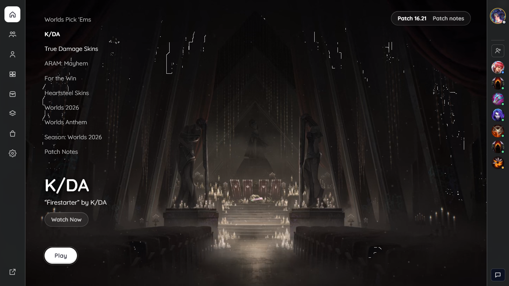
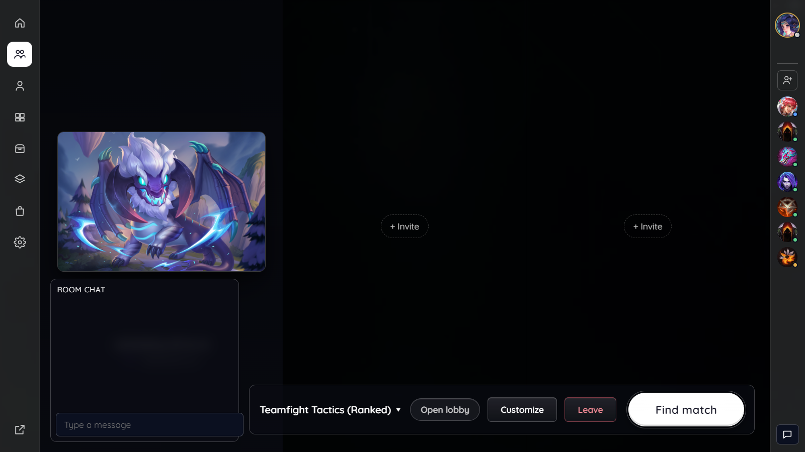
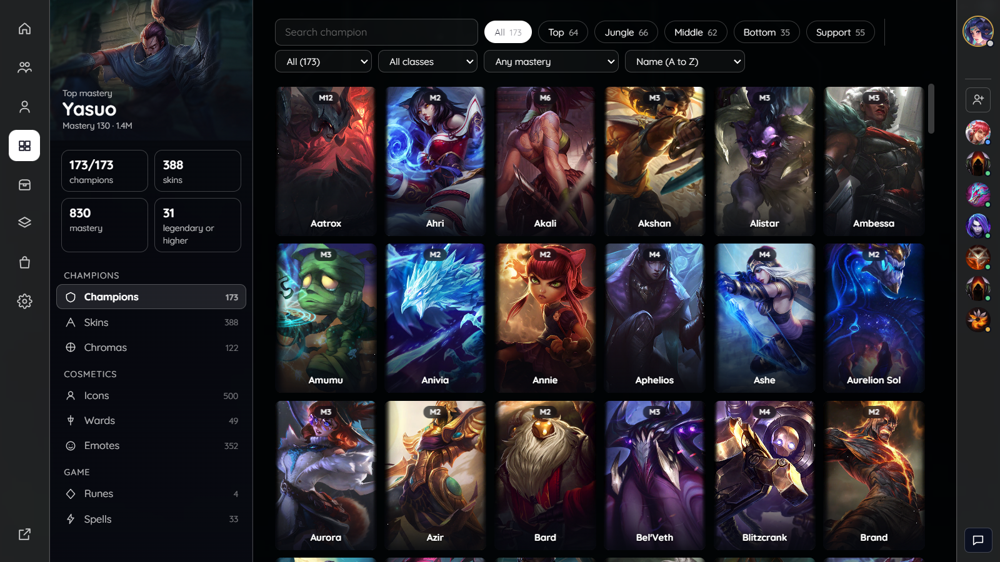
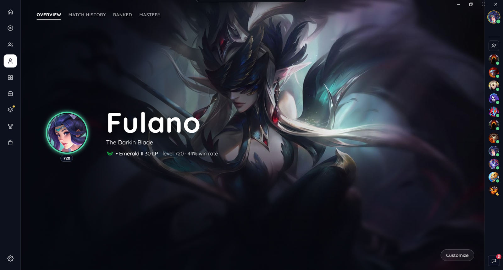
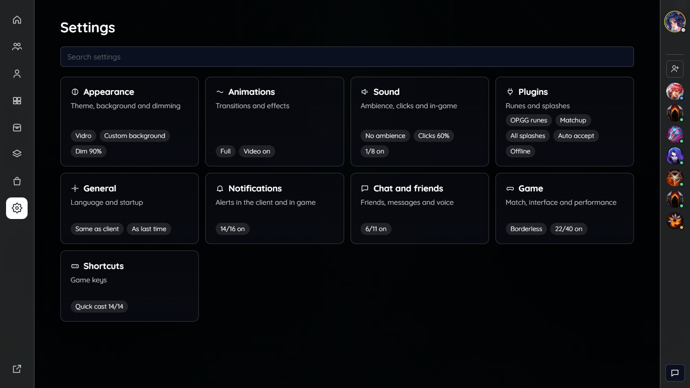
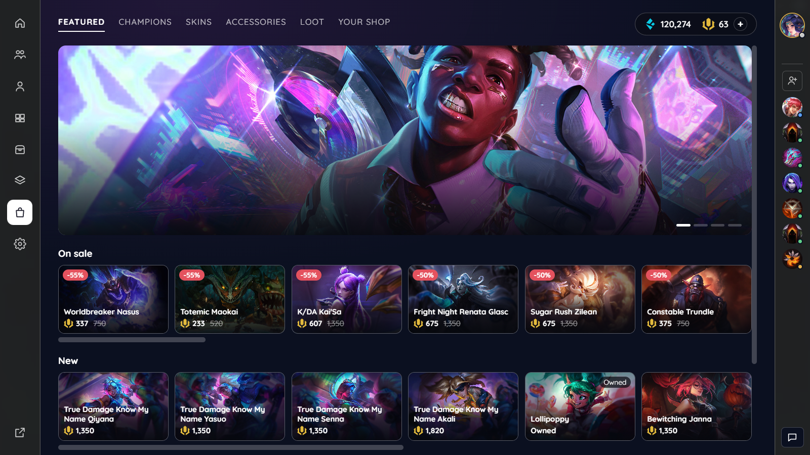
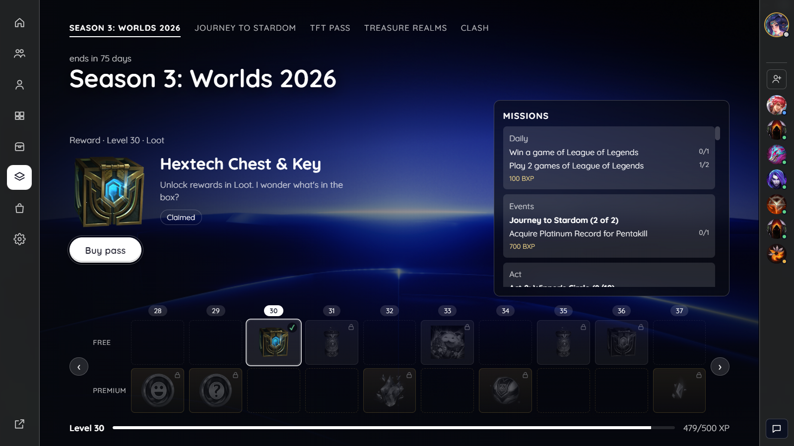

<div align="center">

# ReimaginedLC

**英雄联盟客户端的全新界面，以 [Pengu Loader](https://pengu.lol) 插件形式实现。**

[English](README.md) · [Português](README.pt-BR.md) · 简体中文



</div>

> [!WARNING]
> **非官方项目。** ReimaginedLC 未获得 Riot Games 认可，也与其无任何关联。修改客户端在 Riot 的服务条款中属于灰色地带。Pengu Loader 目前被默许使用，但没有任何保证。使用风险自负。

> [!NOTE]
> 界面目前支持葡萄牙语（巴西）和英语。英雄、物品和队列名称来自客户端本身，会显示为客户端的语言。

## 目录

- [功能](#功能)
- [截图](#截图)
- [安装](#安装)
- [入门](#入门)
- [内置插件](#内置插件)
- [更新](#更新)
- [关闭与卸载](#关闭与卸载)
- [常见问题](#常见问题)
- [主题与语言](#主题与语言)
- [开发](#开发)
- [许可证](#许可证)

## 功能

ReimaginedLC 在原版客户端之上绘制自己的界面。原版客户端在底层继续运行，作为后备：某个界面出错时，ReimaginedLC 会自动关闭，原版客户端随即恢复。

- **主页、房间和排队：** 客户端风格的位置选择器。排队时，角落里的胶囊会显示队列和时间；回到房间时，它会伸展回房间栏。
- **英雄选择：** 舞台上显示大幅原画，并显示队友的真实名称。每张队友卡片显示段位、胜点、胜率和 KDA。另有皮肤轮播、守卫皮肤、按位置收藏英雄（右键）和按对位配置符文。
- **赛后：** 显示比赛结果、你的各项数据在本局中的排名、图表、胜点和成就点数进度，以及谁给了你荣誉。云顶之弈显示排名、每位玩家的阵容与羁绊，以及与你历史战绩的对比。
- **荣誉：** 可以给队友和对手点荣誉，与当前客户端一致。
- **个人资料：** 你的背景、徽章和横幅。点击"比赛历史"会滑出一张毛玻璃面板，显示英雄联盟或云顶之弈的战绩。
- **收藏与战利品：** 筛选与分页、战利品合成与重铸、神话商店和圣所。所有购买都会先要求确认。
- **商店与活动：** 精选皮肤显示名称，原画之间平滑过渡。活动通行证中尚未解锁的奖励显示为禁用状态。
- **好友与聊天：** 抽屉可固定展开，分组记住展开状态，悬停显示资料卡，房间聊天默认打开，并有提示音。
- **设置：** 主题编辑器、背景（图片或视频）、低配电脑的轻量模式，以及语言。

## 截图

| | |
|---|---|
|  |  |
| 房间 | 收藏 |
|  |  |
| 个人资料 | 设置与插件 |
|  |  |
| 商店 | 活动 |

## 安装

### 环境要求

- Windows 10 或 11，并已安装英雄联盟客户端。
- [Pengu Loader](https://pengu.lol) **1.1.6** 或更新版本。

### 安装步骤

1. **安装 Pengu Loader**
   1. 从 [pengu.lol](https://pengu.lol)（或 [GitHub releases](https://github.com/PenguLoader/PenguLoader/releases)）下载。
   2. 打开后点击 **Activate**。操作时请先关闭客户端。
2. **下载 ReimaginedLC**
   - 从 [Releases](https://github.com/kyso1/ReimaginedLC/releases/latest) 下载 `ReimaginedLC-<版本>.zip`。
3. **打开插件文件夹**
   - 在 Pengu Loader 中点击 **Plugins folder**，通常是 `C:\Program Files\Pengu Loader\plugins`。
4. **把压缩包解压到该文件夹**
   - 解压后的结果必须是 `plugins\ReimaginedLC\index.js`。
   - 如果变成了 `plugins\ReimaginedLC\ReimaginedLC\index.js`，请把里面那层文件夹移到上一级。
5. **打开英雄联盟客户端**
   - 如果客户端已经打开，按 **Ctrl+Shift+R** 重新加载。
6. **开启新界面**
   - 按 **Ctrl+Shift+F12**。之后再打开客户端时，新界面会保持开启。

```text
Pengu Loader/
└── plugins/
    └── ReimaginedLC/
        ├── index.js      ← 加载器（负责检查更新）
        └── app/          ← 界面的本地副本
```

## 入门

- **左侧导航栏**是主菜单：主页、开始游戏、个人资料、收藏、战利品、商店、活动和设置。
- 导航栏底部的 **Original client** 可切回 Riot 原版界面。随时按 **Ctrl+Shift+F12** 效果相同。
- 在 **Settings › General** 中可以设置语言、轻量模式，以及是否随客户端启动时打开新界面。
- 在 **Settings › Appearance** 中可以选择主题和背景。

## 内置插件

所有插件默认关闭。请在 **Settings › Plugins** 中开启。

| 插件 | 功能 |
|---|---|
| **自动接受** | 排队匹配成功时自动接受对局。 |
| **显示离线** | 让你的聊天状态保持离线，包括对局期间。 |
| **插件市场** | 从社区插件库安装 Pengu Loader 插件（仅插件，不含主题）。 |
| **ROSE** | 与 [ROSE](https://github.com/Alban1911/Rose)（一个独立的自定义皮肤应用）集成，可在英雄选择的皮肤轮播中直接选择皮肤。ROSE 是第三方工具，有其自身的风险。 |
| **Spotify** | 显示 Spotify 正在播放的歌曲，并可在客户端内控制播放。播放控制需要 Spotify Premium。也可以把歌曲显示在你的状态中。需要一个免费的 Spotify 开发者 Client ID，插件设置中有分步说明。 |

## 更新

压缩包中的 `index.js` 是一个小型加载器。它每 6 小时在 GitHub 上检查一次新版本，并通过 jsDelivr 下载。它只运行签名验证通过的代码（ECDSA P-256 与 SHA-256）。任何一步失败时，都会使用 `app/` 中的本地副本。

更新就绪后，**Settings › General** 中会出现提示和 **Reload** 按钮。它从不自动重新加载，排队、英雄选择和对局期间按钮不可用。

## 关闭与卸载

- **关闭：** 按 **Ctrl+Shift+F12**，或点击导航栏中的 **Original client**。
- **卸载：** 删除 `Pengu Loader/plugins/ReimaginedLC` 文件夹，然后重新加载客户端。
- **移除 Pengu Loader：** 打开 Pengu Loader 并点击 **Deactivate**。

## 常见问题

| 问题 | 解决方法 |
|---|---|
| 安装后没有任何变化 | 确认文件位于 `plugins/ReimaginedLC/index.js`，并且 Pengu Loader 已激活。然后按 **Ctrl+Shift+F12**。 |
| 提示"某个界面出错"，随后原版客户端恢复 | 按 **Ctrl+Shift+R** 重新加载。如果反复出现，请在 **Settings › General › Error report** 中复制报告，粘贴到 [issue](https://github.com/kyso1/ReimaginedLC/issues) 或 AI 中。 |
| 客户端卡顿 | 在 **Settings › General** 中开启 **Lite mode**（关闭毛玻璃模糊，暂停背景视频）。 |
| 对局结束后卡在"等待"界面 | 更新到最新版本；赛后步骤会自动完成。 |

## 主题与语言

- **主题：** 插件自带 Vidro、Vidro lúdico（云顶之弈默认主题）和 Editorial 三个主题。可以在 **Settings › Appearance › New theme** 中创建自己的主题，也可以导入 JSON 文件。主题编辑器可以为 ChatGPT、Claude 等 AI 生成提示词，并把回复直接载入；需要更大的改动时可以使用**自定义 CSS**。参见[主题指南](docs/THEMES.md)（英文）。
- **语言：** 界面目前只有葡萄牙语（巴西）和英语，跟随客户端语言。英雄、物品和队列名称来自客户端本身，已经翻译好。

## 开发

```bash
npm ci
npm test                              # 工具、应用与加载器的测试
npx vite build --mode client          # 构建并复制到 Pengu 插件文件夹
```

- `docs/publicacao.md`（葡萄牙语）说明了发布流程和更新签名。
- 代码规范参见 [CONTRIBUTING.md](CONTRIBUTING.md)。AI 编程助手请阅读 [AGENTS.md](AGENTS.md)。

## 许可证

[MIT](LICENSE)。

本仓库不包含任何 Riot 资源。图标、原画和音效都在运行时从客户端本身加载。League of Legends 是 Riot Games, Inc. 的商标。
